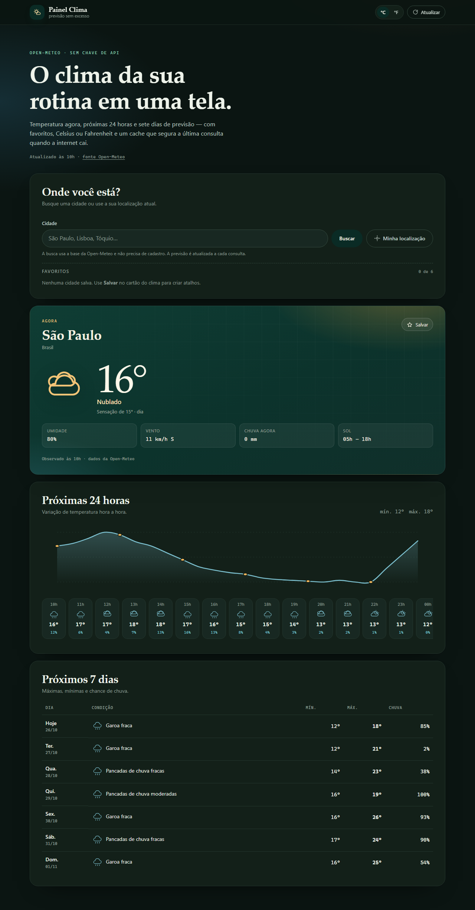
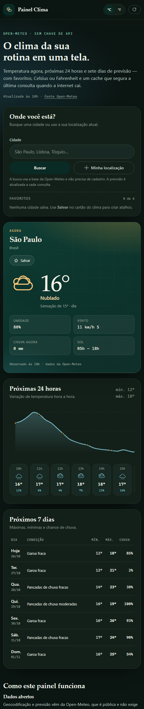

# Painel Clima

[](https://github.com/LeonardoCarrilho/painel-clima/actions/workflows/ci.yml)
[](LICENSE)

Painel de clima em **React + Vite** consumindo a **Open-Meteo**: temperatura
atual, gráfico das próximas 24 horas, previsão de 7 dias, favoritos, troca entre
Celsius e Fahrenheit e modo offline com a última consulta salva.

**Demo:** https://leonardocarrilho.github.io/painel-clima/

| Desktop | Celular |
| --- | --- |
|  |  |

> A Open-Meteo é pública e não exige chave de API. O navegador conversa direto
> com ela, sem back-end intermediário.

## Funcionalidades

- **Clima agora**: temperatura, sensação térmica, condição (códigos WMO
  traduzidos), umidade, vento com direção, chuva e nascer/pôr do sol.
- **Próximas 24 horas**: gráfico SVG suavizado + lista textual hora a hora, com
  ícone, temperatura e chance de chuva.
- **Próximos 7 dias**: tabela com condição, mínima, máxima e probabilidade de
  chuva.
- **Busca de cidades** pela base de geocodificação da Open-Meteo, com sugestões
  quando há mais de um resultado.
- **Localização atual** via `navigator.geolocation` (com mensagem clara quando a
  permissão é negada).
- **Favoritos** salvos no navegador, com limite de 6 e chave por coordenada —
  nomes repetidos não duplicam a lista.
- **Celsius ou Fahrenheit** com a preferência persistida.
- **Cache de 30 minutos**: se a API falhar, o painel mostra a última previsão
  salva com um aviso explícito, em vez de fingir que é leitura ao vivo.
- **Acessível**: tabela com `scope`, lista de horários em texto, `aria-pressed`,
  regiões `role="status"`/`role="alert"`, foco visível, contraste alto e
  respeito a `prefers-reduced-motion`.

## Stack

React 18 · Vite 5 · Vitest · CSS puro com custom properties · Open-Meteo
(geocoding + forecast).

Sem bibliotecas de UI, de estado ou de requisição: o objetivo é mostrar
fundamentos de React (estado, efeitos, `AbortController`, composição) e de CSS
(grid, custom properties, tema escuro automático).

## Como rodar

```bash
git clone https://github.com/LeonardoCarrilho/painel-clima.git
cd painel-clima
npm install
npm run dev      # http://localhost:5173/painel-clima/
npm test         # 51 testes
npm run build    # gera dist/
npm run preview  # serve o build
```

## Decisões de projeto

### Lógica pura separada da interface

`src/lib/weather.js` concentra o que dá para testar sem navegador: descrição dos
códigos WMO, conversão de unidades, rosa dos ventos, formatação de datas, recorte
das próximas horas e a geometria do gráfico (incluindo as curvas de Bézier). Os
componentes só orquestram.

### Cache com validade real

`src/lib/storage.js` guarda a previsão com o instante em que foi salva e só a
considera válida por 30 minutos. O `localStorage` é injetável, então os testes
usam uma implementação em memória e cobrem também cota excedida e JSON
corrompido. O fallback offline só aparece quando o cache é **da mesma cidade** —
mostrar a previsão de outra cidade seria pior que mostrar o erro.

### Uma consulta por mudança de lugar

Cada troca de cidade incrementa um contador (`sequencia`) e dispara um novo
efeito. O efeito devolve um `AbortController` que cancela a requisição anterior,
evitando que uma resposta lenta sobrescreva a cidade selecionada depois. O mesmo
controlador é usado no desmonte.

### Gráfico desenhado à mão

O SVG é gerado a partir dos pontos calculados em `pontosDoGrafico` e das curvas
de `caminhoSuave`. Não há dependência de gráficos, e a lista de horários repete
os mesmos dados em texto para leitores de tela.

### Datas sem deslocamento de fuso

As datas `AAAA-MM-DD` da Open-Meteo são interpretadas ao meio-dia local antes de
formatar. Fazer `new Date("2026-10-26")` criaria meia-noite UTC e, no Brasil,
mostraria o dia anterior.

## Testes

```bash
npm test
```

51 testes em quatro arquivos:

| Arquivo | Cobertura |
| --- | --- |
| `tests/weather.test.js` | códigos WMO, conversões, vento, datas, recorte de horas, geometria do gráfico |
| `tests/storage.test.js` | JSON tolerante a falhas, favoritos, unidade, último lugar, validade do cache |
| `tests/openMeteo.test.js` | URLs montadas, normalização da resposta, erros HTTP/rede, resposta incompleta |
| `tests/components.test.jsx` | renderização dos cartões, tabela, gráfico, busca e ícones via `renderToStaticMarkup` |

Os testes de componente usam `react-dom/server` em ambiente Node — sem jsdom e
sem Testing Library —, o que mantém a suíte rápida e obriga a testar o HTML
gerado (cabeçalhos, rótulos e estados de acessibilidade).

## Estrutura

```
.
├── public/favicon.svg
├── src/
│   ├── App.jsx               # estado, efeitos, busca, favoritos, geolocalização
│   ├── main.jsx
│   ├── styles.css            # tema claro/escuro, layout, estados
│   ├── api/openMeteo.js      # geocoding + previsão normalizada
│   ├── components/           # CurrentCard, HourlyChart, ForecastTable, SearchBar, UnitToggle, WeatherIcon
│   └── lib/
│       ├── weather.js        # regras puras
│       └── storage.js        # localStorage, favoritos e cache
├── tests/
└── vite.config.js
```

## Limitações e próximos passos

- Sem histórico: o painel mostra previsão, não série histórica.
- Sem alertas meteorológicos oficiais.
- O cache guarda apenas a última cidade consultada.
- Evolução natural: gráfico de precipitação, comparação entre cidades e PWA com
  instalação offline.

## Licença

[MIT](LICENSE) © Leonardo Fernandes Carrilho. Dados por
[Open-Meteo](https://open-meteo.com/) (CC BY 4.0).
